# Phase 1

Here's my entire UI for phase 1:

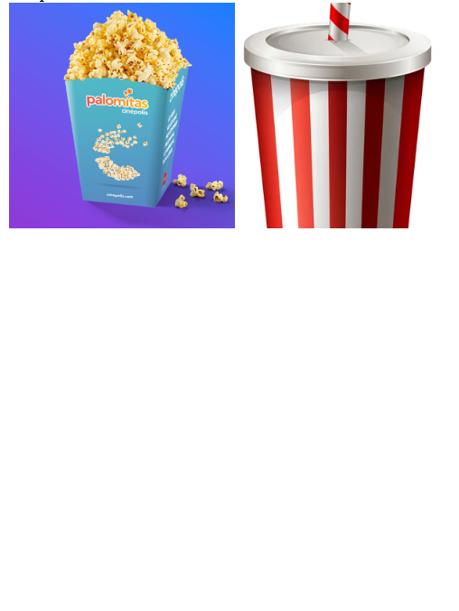
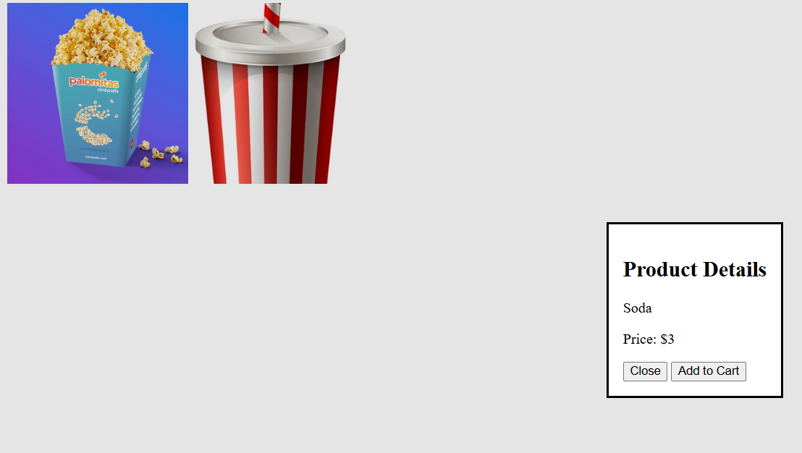
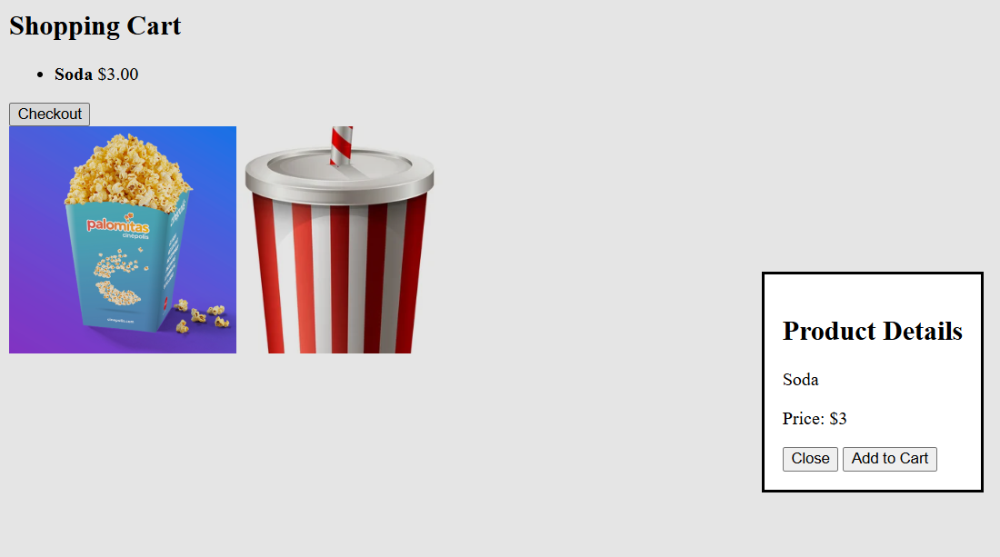
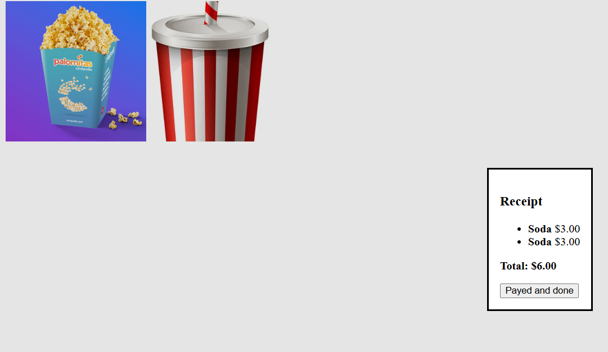

## Phase 1 visibility

My initial implementation of this UI was minimally visible because:

* :-1: It is not clear at any given time what are the possible actions at the start screen (Am I just staring at the pictures?, can I click on them?) 

* :-1: The checkout button which is possible at sometimes it is not being showed instead of disabled 

* :-1: The user know as they click on the pictures what state are they in but it might not be intuitive at the beginning of the app

## Phase 1 feedback

My initial implementation of this UI had adequate feedback:

* :+1: After the user clicked  add the product to the cart, the system is informing the user that the product now is in the cart 

## Phase 1 consistency

My initial implementation of this UI looked terrible, but had good consistency:

* :+1: All buttons in the app had appropriate labels with verbs.

* :+1: Same flow for adding two different products

# Phase 2 

Here are the major new parts of my interface for phase 2:

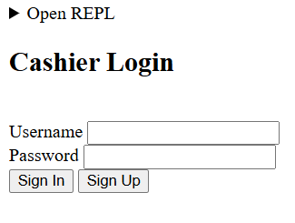

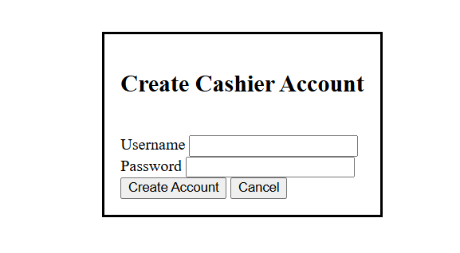

Here's the main UI as I submitted it for phase 2:

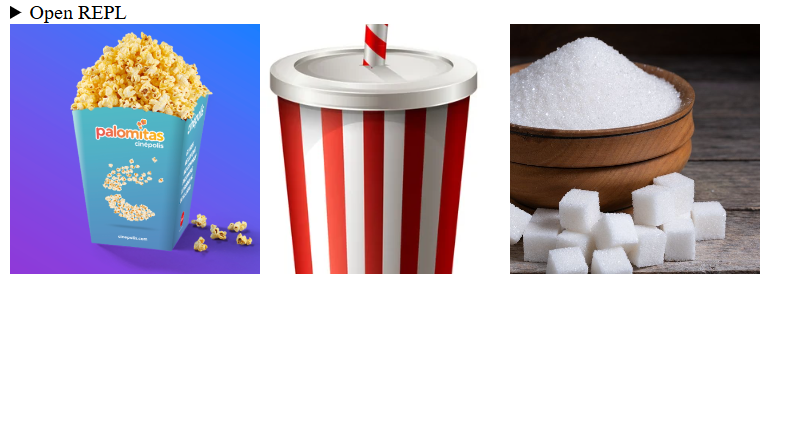
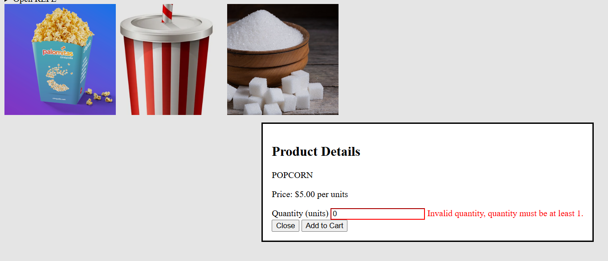
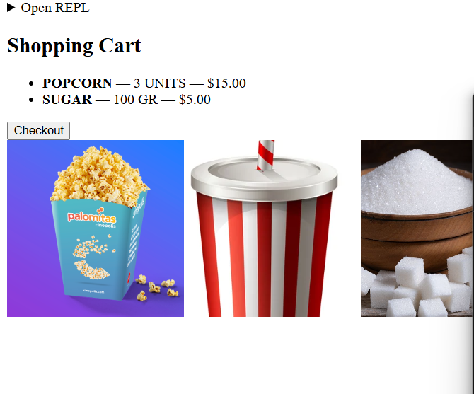
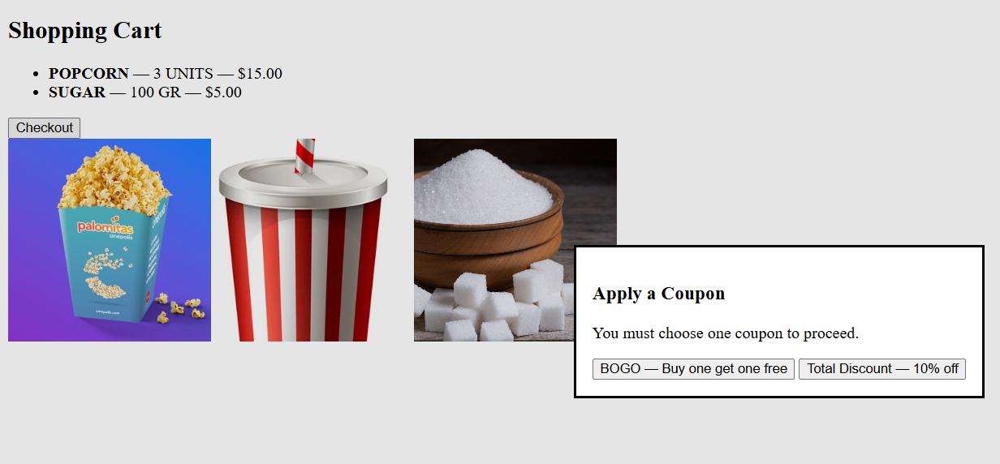
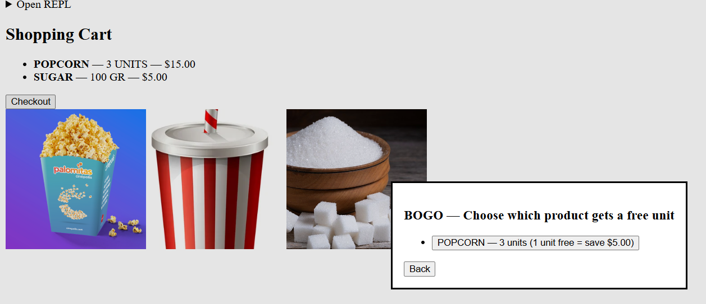
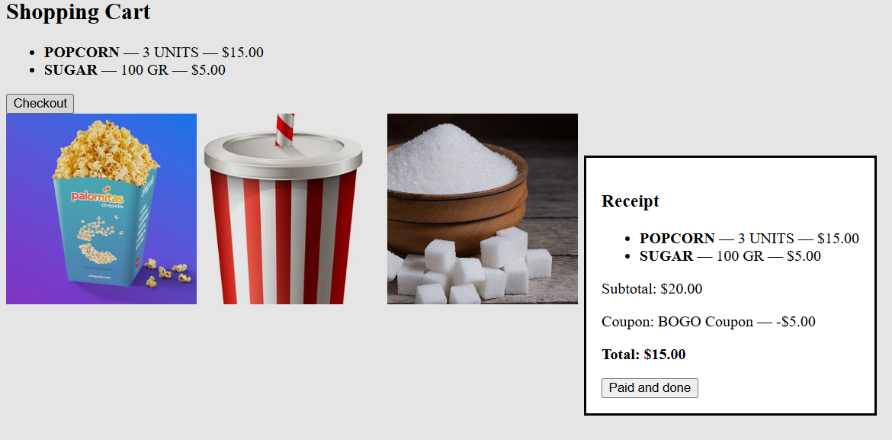

## Changes from phase 1

* The main changes I made from phase 1 to phase 2 was to add a login and sign up system, as well as input fields for quantity of the products being added and a coupon system at checkout .

## Phase 2 visibility

My implementation of this UI was minimally visible because:

* :-1: Still it is not clear at any given time what are the possible actions once logged in (can I click pictures?)

* :-1: The checkout button which is a possible action still is not being showed instead of disabled 

* :+1: when checking out and choosing between a bogo coupon or total discount if the cart does not have at least 2 items of the same type it will be disabled for bogo coupon

* :+1: After clicking one product picture it is clear and what state we are in 

* :-1: Still not clear once we logged in what state are we in by the information on the screen 

## Phase 2 feedback

My implementation of this UI had adequate feedback:

* :+1: if username or password is not found in the db it clearly inform the user and how to fix it as well as if the username or password is too short it inform the user and how to fix it or if its creating an account with an username already in db

* :+1: when typing username or password in sign in screen or sign up, the system informs the user that it is typing by showing them character by character 

* :+1: when adding a product quantity that is less than 1, the system informs the user and how to fix it

* :+1: when typing product quantity for a product the system informs that the user is typing correct input

## Phase 3 consistency

My implementation of this UI still is bad, but had good overall good consistency with some drawbacks:

* :-1: Not all buttons had appropiate labels with verbs like in the apply coupon flow which has no verbs

* :+1: Similar operations flow in the same way 

* :+1: All input fields had labels

## How I might change my UI

* Add labels to my product images so it is clear that you should click them

* Make the shopping chart visible after logged in and disable the checkout button with a message that you should add a product first instead of not being showed at first

* Make all buttons to have verbs 